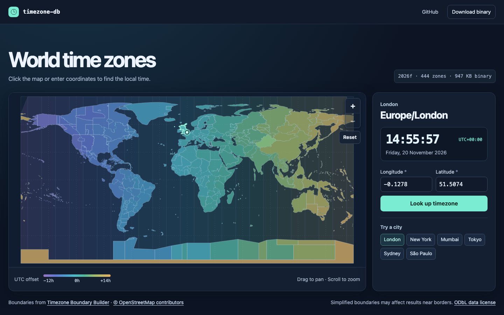

# timezone-db

Look up an IANA timezone by longitude and latitude using a single offline binary. The world database includes every timezone in the imported release with oceans and fits under 1 MB.

[](https://robertpitt.github.io/timezone-db/)

## Demo

Click the map, enter coordinates, or pick a city to see the timezone and local time. The page reads and draws the boundaries from the same world.tzdb used for lookups. [Open the GitHub Pages demo](https://robertpitt.github.io/timezone-db/)

To preview locally, run `npm run build:pages` and serve `build/pages` with a static HTTP server.

## Comparison

The versions below use Timezone Boundary Builder 2026f.

| Project | Lookup assets | Unpacked npm package | Runtime | Lookup behavior |
| --- | --- | ---: | --- | --- |
| `timezone-db` 0.1.0 preview | 947 KB `.tzdb` + 102 KB JavaScript | 1.10 MB | Browsers, Node.js, Deno, Bun | Queries simplified polygons. `lookup` returns the first match or `null`, and `lookupAll` returns every match. `polygonShapes` exposes the geometry for drawing. |
| [`geo-tz` 8.1.11](https://github.com/evansiroky/node-geo-tz/tree/v8.1.11) | 31.17 MB of data for `geo-tz/all` | 74.48 MB | Node.js with disk access | Performs exact lookups against upstream boundaries and falls back to ocean zones. `find` returns an array of timezone IDs. |
| [`@photostructure/tz-lookup` 11.8.0](https://github.com/photostructure/tz-lookup/tree/11.8.0) | 73.4 KB `tz.js` with code and data | 88.0 KB | Browsers and Node.js | Queries a lossy quadtree and returns one estimated timezone ID. |

Sizes use decimal units and are measured from the npm tarball contents before compression. The full `geo-tz` package contains three datasets. The `timezone-db` size comes from a locally packed build.

## Build

Use Node.js 24 to build from the prepared world topology in data.

```sh
npm ci
npm run build
npm test
```

The build generates dist/world.tzdb, the portable JavaScript module, and its TypeScript declarations.

## Query

The client takes an ArrayBuffer or Uint8Array, including a Node Buffer. In a browser, pass the ArrayBuffer returned by fetch. In Bun, the same API accepts bytes from Bun.mmap. Keep the bytes immutable for the lifetime of the client.

```js
import { readFile } from 'node:fs/promises'
import { TimezoneClient } from '@robertpitt/timezone-db'

const file = new URL(import.meta.resolve('@robertpitt/timezone-db/world.tzdb'))
const db = new TimezoneClient(await readFile(file))

db.lookup(-0.1278, 51.5074)    // "Europe/London"
db.lookupAll(-0.1278, 51.5074) // ["Europe/London"]
```

Supply coordinates in decimal degrees, longitude first. lookupAll returns every match in source order, including shared edges and overlaps. lookup returns the first match or null. The client reads the indexes directly from the supplied bytes and decodes geometry blocks on demand.

## Package

GitHub Actions builds and tests dist, then uploads the npm tarball as the npm-package artifact. The package name is @robertpitt/timezone-db and publication is manual.

## Automated data updates

The **Update timezone data** workflow checks Timezone Boundary Builder every six hours. It verifies a new archive against the upstream checksum and rebuilds with the 150 m simplification profile and selective coordinate rounding. The update must preserve every timezone, polygon part, and ring, pass the geometry and lookup tests, and fit under 1 MB.

After validation, the workflow commits the binary, prepared topology, and release metadata to main and starts the Pages and npm package build. A manual run also verifies the current release. During longer intervals between releases, the workflow records a check every 42 days to keep the schedule active.

## Data and attribution

The release manifest records the source version and checksums. The checked-in TopoJSON snapshot is the build input, and the build verifies the resulting binary against the committed copy. Boundary simplification and selective coordinate rounding can affect lookups near borders. [Release manifest](data/release.json) · [Timezone Boundary Builder releases](https://github.com/evansiroky/timezone-boundary-builder/releases)

Timezone boundary data © OpenStreetMap contributors. The prepared topology and the derived binary are distributed under the Open Data Commons Open Database License 1.0. [Data license](DATA-LICENSE.txt) · [OpenStreetMap attribution](https://www.openstreetmap.org/copyright)

Bundled dependency notices are in [THIRD-PARTY-NOTICES.txt](THIRD-PARTY-NOTICES.txt).
